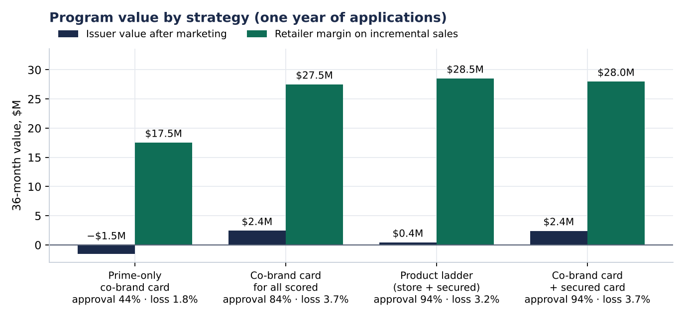
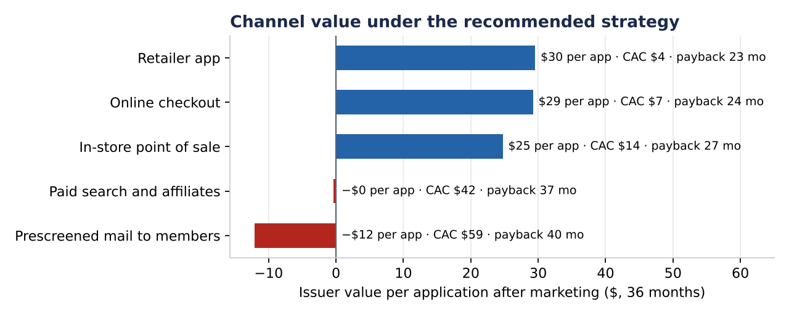
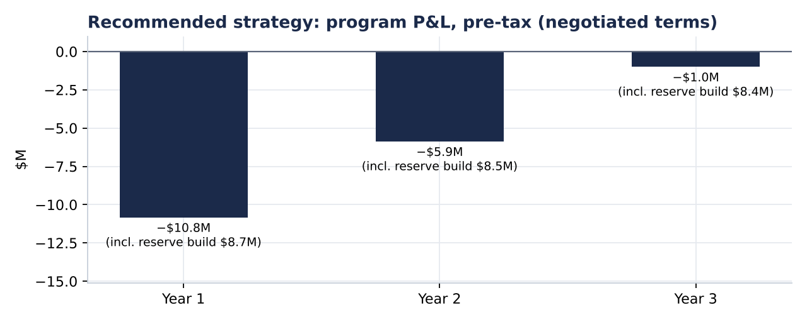

# Case 1: Launching a retail co-brand card program

**The question:** a large membership retailer and its card issuer are launching a co-brand program. Which applicants get which card, through which channels, on what partner terms, to maximize total program value while meeting the retailer's approval goal and surviving a downturn?

This is the Capital One Marketing & Analysis question: marketing (channels, offers, approval at checkout), credit (who gets what product and line) and finance (NPV, P&L, CECL, funding) decided together on one number.

**Read first:** [`reports/decision_memo.md`](reports/decision_memo.md)

## What the model does

1. **Unit economics** for every product x segment cell (co-brand card, store card, secured card x prime, near-prime, subprime, thin-file): 36-month NPV per account for the issuer and incremental margin for the retailer.
2. **Response x approval x NPV** across five acquisition channels and four strategies.
3. **Downturn stress:** default rates x1.5, revolving balances -20%.
4. **Deal structure:** who funds the account bounty, and how value moves between issuer and retailer.
5. **Three-year program P&L** from monthly cohorts, with a CECL reserve build, warehouse borrowing and equity need.

## Key results (simulated)

| Strategy | Approval | Program value | Issuer value |
|---|---|---|---|
| A. Prime-only co-brand card | 44% | $16.0M | −$1.5M |
| B. Co-brand card for all scored | 84% | $29.9M | $2.4M |
| C. Product ladder | 94% | $28.9M | $0.4M |
| **D. Co-brand card + secured card** | **94%** | **$30.4M** | **$2.4M** |





## Run it

```bash
pip install numpy pandas matplotlib pytest
python cases/cobrand_launch/run_case.py
pytest -q tests
```

All assumptions are in [`src/assumptions.py`](src/assumptions.py), labeled as assumptions. No company's data is used.
